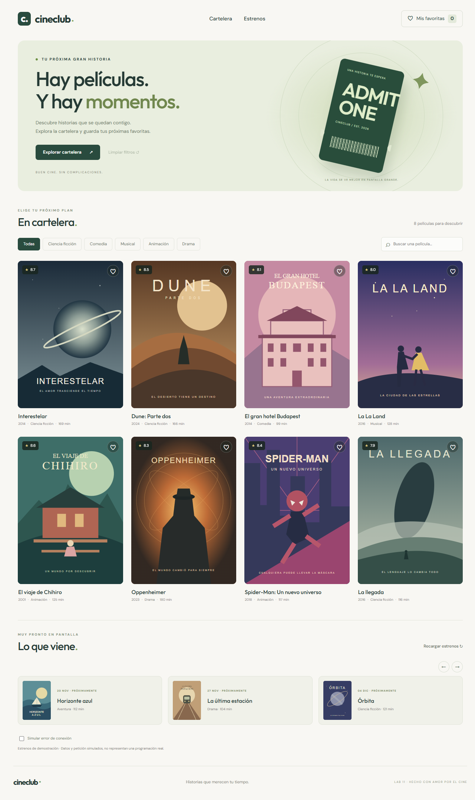

# Evidencias · Laboratorio 11

Fecha: 13/11/2026. Rama: `lab11`.

## Automatizadas

- `tests.txt`: salida de `npm.cmd test`.
- `build.txt`: salida de `npm.cmd run build`.
- 75 pruebas aprobadas en ocho archivos, sin fallos ni errores sin capturar.
- Las 18 pruebas nuevas cubren adaptador, tarjeta desacoplada, contador, favoritos, avisos, filtros, persistencia, columnas, estrenos y limpieza.

## Navegador real

Se abrió la aplicación servida por Vite en `http://localhost:5173` mediante Chromium y se realizaron las siguientes comprobaciones automatizadas:

| Acción | Resultado observado |
| --- | --- |
| Abrir la cartelera | Ocho tarjetas, cuatro columnas en el ancho de escritorio |
| Inspeccionar imágenes cargadas | Ninguna imagen rota |
| Añadir Interestelar | Contador `1`, aviso “Interestelar: añadida a tus favoritas.” |
| Quitar Interestelar | Contador `0`, aviso “Interestelar: eliminada de tus favoritas.” y almacenamiento `[]` |
| Buscar Dune | Campo `Dune`, una tarjeta: `Dune: Parte dos` |
| Limpiar desde el banner | Campo vacío y ocho tarjetas |
| Inspeccionar consola tras marcar y desmarcar | Sin errores |
| Activar fallo de estrenos | Error visible, sin carrusel |
| Pulsar Reintentar | Esqueleto visible, error anterior retirado |
| Desactivar fallo | Cuatro estrenos cargados y ningún aviso de error |

La captura de escritorio está en `cartelera.png`. Los escenarios de 390, 700, 1000 y 1280 px, cancelación de temporizadores, StrictMode y recuperación de errores se verifican además en las pruebas automatizadas, sin atribuirlas a comprobaciones manuales del alumno.

La instalación reportó tres vulnerabilidades en dependencias (una moderada y dos críticas); no se aplicaron actualizaciones mayores automáticas.
